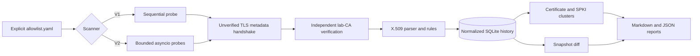

# X.509 Asset and Certificate Exposure Monitor

A safety-first certificate-intelligence pipeline for explicitly authorized TLS endpoints. It inventories leaf certificates and available chains, verifies trust independently from metadata collection, records normalized history in SQLite, clusters endpoints by certificate and public key, and explains security-relevant changes.

This project scans only entries in an explicit allowlist. Its checked-in default contains eight loopback endpoints created by the included Docker Compose lab. It does not discover hosts, expand CIDR ranges, evade controls, or scan the public Internet.

## Quick start

Prerequisites: Python 3.9+, Docker with Compose, and `make`. Every target must be owned by you or explicitly authorized.

```bash
make install
make lab-generate
make test
make lab-start
make scan-v1
make scan-v2
make diff
make lab-stop
```

The repository path contains a colon, which Unix treats as a `PATH` separator. `make install` therefore creates the virtual environment at `~/.cache/x509-exposure-monitor-venv` and places a `.venv` symlink here. Override `VENVDIR` if desired. The lab bakes freshly generated disposable keys into local images to avoid the same colon breaking Docker bind mounts.

## What the lab proves

The generator creates a fresh CA and eight endpoints, then writes exact fingerprints and expected detector labels to `lab/certs/ground_truth.json`:

| Endpoint(s) | Seeded condition |
|---|---|
| `valid` | lab-CA-issued, valid SAN and dates |
| `expired` | lab-CA-issued but expired; metadata still collected |
| `hostname-mismatch` | trusted certificate whose SAN does not match the requested server name |
| `self-signed` | valid metadata and hostname, untrusted issuer |
| `shared-cert-a/b` | identical complete certificate and private key |
| `shared-spki-a/b` | distinct certificates and SANs signed over the same public key |

All generated private keys are disposable lab fixtures under the ignored `lab/certs/` tree. Never reuse them. Only the machine-readable manifest is retained as a reproducibility artifact.

## Architecture



Each probe first uses `CERT_NONE` solely to retrieve metadata from expired, mismatched, or untrusted peers. A separate connection verifies the chain against the configured CA with hostname checking disabled; SAN matching is calculated independently. This keeps “trusted by this CA,” “valid for this hostname,” and “collectable metadata” as distinct facts.

The V2 semaphore wraps the complete probe, including both handshakes. A tracker increments inside the semaphore and records the observed peak. Tests cancel an in-flight scan and assert that all named probe tasks finish cleanup.

## X.509 and fingerprint choices

An X.509 certificate binds an identity and validity interval to a public key under an issuer signature. SANs are the authoritative DNS/IP identities; the subject common name is retained for inventory but is not used for matching.

The certificate SHA-256 fingerprint hashes the complete DER certificate. Equal values mean the same serialized certificate, including issuer, serial, dates, SANs, and key. The SPKI SHA-256 fingerprint hashes only DER `SubjectPublicKeyInfo`. Equal SPKIs mean the same public key even when certificates differ. Therefore:

```text
certificate 33:2D:…
├── shared-cert-a
└── shared-cert-b

SPKI 39:1D:…
├── shared-spki-a  (certificate 8E:37:…)
└── shared-spki-b  (certificate 15:8D:…)
```

The inventory also records subject, issuer, SANs, serial, UTC validity boundaries, signature algorithm/hash, key type/size, negotiated TLS version/cipher, collection time, target, verification status, chain fingerprints when the interpreter exposes the chain API, and classified errors.

## Safety and authorization model

- An allowlist file is mandatory; an empty list is rejected.
- `authorization_acknowledged: true` is mandatory.
- Targets must resolve only to loopback, private, or link-local addresses by default.
- A non-private target needs both a deliberate `allow_public_targets: true` change and an explicit list entry. This is an opt-in gate, not authorization; the operator remains responsible for permission.
- CIDR/range discovery is unsupported, conservative timeouts are enforced, concurrency is capped at 100, and defaults are two seconds/five probes.
- The Docker ports bind to `127.0.0.1` only. There is no stealth, evasion, banner exploitation, or write operation against targets.

DNS answers can change after validation (DNS rebinding). For high-assurance use, prefer literal authorized IPs or enforce destination policy at the network layer.

## CLI

```bash
# lab lifecycle
x509-monitor lab generate
x509-monitor lab start
x509-monitor lab rotate --target valid
x509-monitor lab rotate --target valid --reuse-key
x509-monitor lab stop

# history and output
x509-monitor init-db
x509-monitor scan --mode v1 --json scan.json --markdown scan.md
x509-monitor scan --mode v2 --concurrency 5
x509-monitor diff --previous 1 --current 2 --json diff.json
x509-monitor report --scan-id 2 --json report.json
x509-monitor evaluate --scan-id 2

# reproducible local sweep and plots
x509-monitor benchmark --repeat-endpoints 5 --runs 3 --concurrency 1,5,10,25,50
x509-monitor plot artifacts/benchmarks/benchmark-TIMESTAMP.json
```

`lab generate` replaces all disposable lab keys and the manifest, so run it before `lab start`. `lab rotate` updates one certificate, rebuilds that service, and waits for its loopback port before returning.

## History and change semantics

Every scan is an immutable snapshot with UTC `started_at`/`completed_at`. A certificate is stored once by full fingerprint; endpoints are stored once by stable `name@host:port`; one observation per endpoint per scan makes retries within a stored run impossible. Repeated command runs intentionally create new snapshots rather than overwriting evidence.

Diffs compare two explicit scan IDs and report first seen, certificate rotation, key rotation or reuse, issuer/SAN changes, disappearance (including loss of a previously collectable certificate), reappearance, and impending expiry. An expired certificate also qualifies for the configured expiry warning in historical reports. Missing endpoints are meaningful only relative to the two allowlists used for those snapshots.

See [the schema guide](docs/SCHEMA.md), [the demo](DEMO.md), and sanitized [V2 report](artifacts/reports/sample-v2.md).

## Correctness results

On 2026-09-09, the full suite passed **17/17 tests** on the generated local lab. The ground-truth evaluation reported detector precision **1.00** and recall **1.00** for the defined seeded categories (expired, untrusted, and SAN mismatch): 4 expected/4 observed, with no missed or incorrect labels. Shared-certificate and shared-SPKI relationship precision/recall were also **1.00/1.00**, with no missed or incorrect groups. These are local seeded-condition results, not generic vulnerability-detection accuracy.

V1 and V2 returned identical findings and fingerprints. With a configured V2 limit of five, observed peak concurrency was exactly five and never exceeded the bound. A real new-key rotation of `valid` produced exactly the two expected rotation relationships, `certificate_rotation` and `key_rotation` (precision/recall 1.00/1.00); the scoped evidence is in `artifacts/reports/change-evaluation.json`.

## Local benchmark results

The included raw run repeated the eight endpoints five times (fixed N=40), ran every configuration three times, and performed the same two TLS handshakes per probe. Results are means; raw per-run JSON/CSV include platform, Python, OpenSSL, dependency, timeout, errors, memory, and ground-truth metrics.

| Mode | Concurrency | Mean wall ms | Mean endpoints/s | Mean p50 ms | Mean p95 ms | Mean peak traced MiB | Max active |
|---|---:|---:|---:|---:|---:|---:|---:|
| V1 | 1 | 188.7 | 216.4 | 4.3 | 6.5 | 0.18 | 1 |
| V2 | 1 | 238.6 | 171.8 | 5.6 | 8.1 | 3.55 | 1 |
| V2 | 5 | 100.1 | 412.4 | 11.3 | 17.8 | 4.13 | 5 |
| V2 | 10 | 77.2 | 522.5 | 17.0 | 26.1 | 6.65 | 10 |
| V2 | 25 | 71.0 | 565.7 | 40.1 | 51.6 | 13.31 | 25 |
| V2 | 50 | 74.0 | 545.4 | 64.5 | 67.2 | 21.11 | 40* |

`*` Only 40 endpoint jobs existed, so the observed peak could not exceed 40. Every benchmark probe completed without a connection error, every seeded detector evaluation remained 1.00 precision/recall, and the no-change replay against the generated manifest had 1.00 change-detection accuracy. On this machine, throughput peaked at configured concurrency 25; 50 added latency and memory without improving throughput. These measurements apply only to an Apple-arm local Docker lab on macOS 26.6.2, Python 3.14.7, and OpenSSL 3.6.4. They make no claim about Internet scale.

Generated plots: [throughput](artifacts/plots/throughput-20260909T191243Z.png) and [latency](artifacts/plots/latency-20260909T191243Z.png). The corresponding [JSON](artifacts/benchmarks/benchmark-20260909T191243Z.json) and [CSV](artifacts/benchmarks/benchmark-20260909T191243Z.csv) are retained as scoped portfolio evidence.

## Limitations

- Python exposes peer-chain methods inconsistently, so the leaf is always captured but intermediate chain fingerprints may be empty on some interpreters.
- The scanner performs TCP TLS, not STARTTLS, QUIC, client-certificate, proxy, or application-layer checks.
- Hostname matching supports exact SANs and a single wildcard in the complete leftmost label; IDNA normalization and name constraints are delegated neither to this small matcher nor to the lab.
- “Trust” is validation against the configured CA at collection time, not a universal trust judgment. Revocation, CT inclusion, OCSP, policy OIDs, and path-building diagnostics are outside scope.
- The benchmark repeats loopback services; it measures local scheduling/handshake overhead, not remote network performance.

## Resume bullets (measured and scoped)

- Built an allowlist-only Python X.509 intelligence pipeline with sequential and bounded-async scanners, normalized SQLite history, JSON/Markdown reporting, and certificate-versus-SPKI relationship analysis.
- Achieved 1.00 precision and 1.00 recall on four seeded local detector labels and 1.00/1.00 on shared-certificate and shared-key groups across an eight-endpoint Docker TLS ground-truth lab (17/17 tests passing).
- Measured 565.7 mean local endpoints/s at concurrency 25 over 40 loopback probes, 2.61× the 216.4 endpoints/s sequential mean, while instrumenting and verifying the concurrency bound; no public-scale claim implied.

## Development and license

Run `make test` for the complete local integration suite and `make package` to validate the Python distribution. Both `make test` and `make benchmark` start the local lab when needed and always run `docker compose down` afterward, including on failure. Docker volumes are preserved.

Contributions are described in [CONTRIBUTING.md](CONTRIBUTING.md). Released under the [MIT License](LICENSE). Use only on systems you own or are explicitly authorized to assess.
